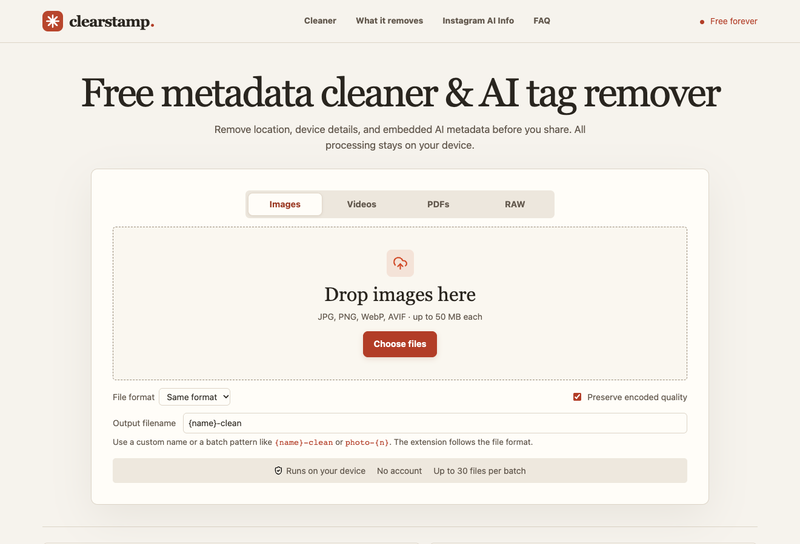

# Clearstamp

Remove the location, camera details, and AI metadata attached to a file before you share it. Clearstamp runs in your browser, so the files you choose stay on your device. Batch cleaning and ZIP downloads are free, and you can start without an account.

**[Open Clearstamp](https://clearstamp-metadata-cleaner.pages.dev/)**

[](https://clearstamp-metadata-cleaner.pages.dev/)

## Clean your first batch

1. Choose a file type, then drop in your files. A batch accepts up to 30 files of that type, with a 250 MB combined limit.
2. For images, choose an output format and a filename. Enter a custom name or use a pattern like `{name}-clean` or `photo-{n}`. The file extension follows the output format.
3. Click **Clean files**. For an image, use **Inspect original** or **Inspect cleaned** to compare the tags and save a JSON report. Download files individually or together as a ZIP.

| File type | What Clearstamp does |
| --- | --- |
| JPEG, PNG, WebP, AVIF | Strips supported EXIF, GPS, XMP, IPTC, text fields, and embedded Content Credentials. Preserve mode keeps the JPEG, PNG, or WebP encoding when orientation correction is unnecessary. AVIF export varies by browser. |
| MP4, MOV | Clears common container tags and timestamps while keeping the audio and video tracks. Track-level or codec metadata can remain. |
| Unencrypted PDF | Clears document properties and XML metadata. It keeps page content and attachments. Rewriting can invalidate digital signatures. |
| Camera RAW | Extracts a cleaned JPEG from the best readable embedded preview. |

The image inspector flags embedded AI signals such as generator names, saved prompts, and declared digital source types. It checks metadata only. An image with no readable signals can still be AI-generated, and Instagram and other platforms make their own labeling decisions.

## Run locally

Clearstamp is a static site built with HTML, CSS, and JavaScript. The dependencies are included, so there’s no install or build step.

```sh
git clone https://github.com/creatifying/clearstamp-metadata-cleaner.git
cd clearstamp-metadata-cleaner
python3 -m http.server 8080 --bind 127.0.0.1 --directory public
```

Open [localhost:8080](http://127.0.0.1:8080/).

### Use the cleaner from JavaScript

With the page’s scripts loaded, pass a local `File` to the browser API:

```js
const { blob, ext, note } = await Clearstamp.clean(file, "image", {
  format: "original",
  lossless: true,
});
```

The supported modes are `image`, `video`, `pdf`, and `raw`. For image conversion, pass a target MIME type such as `image/png`.

### Deploy your own copy

On Cloudflare Pages, set the output directory to `public` and leave the build command empty. For an existing Direct Upload project, run:

```sh
wrangler pages deploy public --project-name YOUR_PROJECT --branch main
```

## Credits

Clearstamp is maintained by [Creatifying](https://github.com/creatifying). The alpine and coastal illustrations were generated for this project.

- [Lucide](https://lucide.dev/) for icons and [Manrope](https://github.com/sharanda/manrope) for typography.
- [ExifReader](https://github.com/mattiasw/ExifReader) for metadata parsing, [pdf-lib](https://pdf-lib.js.org/) for PDFs, and [fflate](https://github.com/101arrowz/fflate) for ZIPs.

Third-party licenses are included in [public/icons](public/icons) and [public/vendor](public/vendor).
